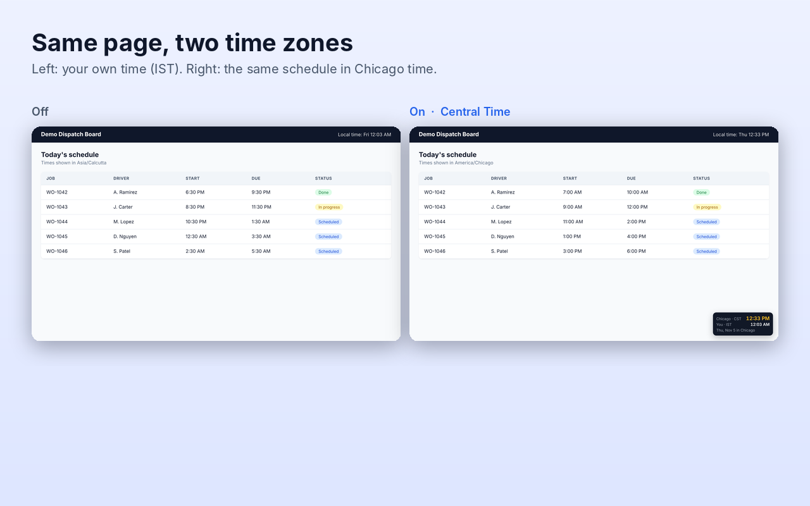

# TimeZone Shift

A Chrome extension that makes any website show its times in a different time zone, without changing your computer's clock.

Useful when you schedule work for people in another time zone: dispatch and fleet tools, booking systems, admin panels, calendars. Instead of converting every time in your head, switch the site to their zone and read the times as they will see them.



## Features

- **Switch a site to any time zone.** Every IANA zone is supported (400+). The setting is remembered per site, so different sites can use different zones.
- **Searchable zone picker.** Type a city (`Dallas`), country (`Japan`), abbreviation (`IST`, `PST`, `CET`) or offset (`UTC+2`).
- **Floating clock** on switched sites, showing the site's time next to yours. Drag it anywhere; click to minimise.
- **Quick converter.** Convert any date and time between two zones, with a Copy button. Works on any page.
- **Handles daylight saving** on both sides automatically.
- 12- or 24-hour clock, light and dark mode.
- No accounts, no tracking, no network requests.

## How it works

Chrome has a built-in time zone emulation feature (the same one in DevTools → Sensors). TimeZone Shift turns it on for the tabs of the sites you choose, using the `chrome.debugger` API to call `Emulation.setTimezoneOverride`. The site's JavaScript (`Date`, `Intl` and everything built on them) then behaves as if your computer were in that zone.

Because it uses the debugger API, Chrome shows a bar saying the extension "started debugging this browser" while a switched site is open. That bar is expected. Clicking **Cancel** on it switches the site off.

### Limits

- It changes the time zone the **browser** reports. Sites that format times on the server using a time zone saved in your account settings won't change. Use that account setting instead.
- Chrome pages (`chrome://`, the Chrome Web Store) can't be switched.

## Install from source

1. Clone or download this repository.
2. Open `chrome://extensions` in Chrome.
3. Turn on **Developer mode** (top-right).
4. Click **Load unpacked** and select the `src` folder.

## Project layout

```
src/
  manifest.json     Manifest V3
  background.js     Service worker: attaches to switched tabs and applies the override
  content.js        Floating clock (Shadow DOM, so it doesn't clash with site styles)
  popup.html/.css/.js  Toolbar popup: site switch, converter, settings
  picker.js         Searchable time zone picker
  zones.js          Shared time zone helpers (offsets, DST-safe conversion, search)
  icons/
docs/screenshots/   Store screenshots and promo tile
scripts/package.sh  Builds the zip to upload to the Chrome Web Store
```

## Build for the Chrome Web Store

```sh
./scripts/package.sh
```

This creates `dist/timezone-shift-<version>.zip`. See [STORE_LISTING.md](STORE_LISTING.md) for the listing text and permission justifications, and [PRIVACY.md](PRIVACY.md) for the privacy policy.

## Contributing

Issues and pull requests are welcome. Please test changes with **Load unpacked** before opening a PR.


